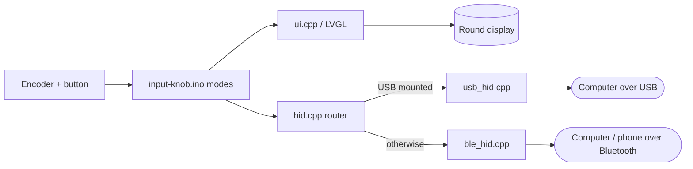

# Input Knob

> Turn an Elecrow CrowPanel 1.28" ESP32-S3 rotary display into a volume, scroll, shortcut and mini-trackpad knob for your computer, phone or tablet, over USB or Bluetooth.

Arduino + LVGL firmware for the **Elecrow CrowPanel 1.28" HMI ESP32 Rotary Display** (240x240 round GC9A01 touch screen, rotary encoder with push button, 5-LED ring). The knob shows up as an ordinary keyboard + mouse + media-key device, so the host needs no driver or companion app. It is not a general macro-pad framework: there are four fixed modes, and shortcuts are edited in code.

---

## Quick Start

**Just want to use it?** Download the prebuilt firmware from the [latest release](https://github.com/bsommers/input-knob/releases/latest) and flash it from your browser; the release notes have the steps. No Arduino setup needed.

**Building from source:** you need the knob, a USB-C data cable, a Mac (Windows/Linux work too; see [HOWTO](docs/HOWTO.md)) and the [Arduino IDE 2](https://www.arduino.cc/en/software) with the **esp32 by Espressif** 3.x board package.

```bash
# 1. Get the code
git clone https://github.com/bsommers/input-knob.git && cd input-knob

# 2. Install the exact LVGL / LovyanGFX / NeoPixel versions Elecrow ships, plus lv_conf.h
git clone --depth 1 https://github.com/Elecrow-RD/CrowPanel-1.28inch-HMI-ESP32-Rotary-Display-240-240-IPS-Round-Touch-Knob-Screen.git /tmp/elecrow
mkdir -p ~/Documents/Arduino/libraries
cp -R /tmp/elecrow/example/Arduino/libraries/{lvgl,LovyanGFX,Adafruit_NeoPixel,lv_conf.h} ~/Documents/Arduino/libraries/

# 3. Plug the knob in and upload (board settings come from sketch.yaml)
./upload.sh
```

The screen lights up with **Volume** in blue and **USB** in green at the top. Turn the knob and the computer's volume follows.

> First flash over Elecrow's factory firmware? If `upload.sh` can't connect, hold **BOOT**, plug the knob in, release, and run it again.

---

## What It Does

- **Controls volume**: turn for volume up/down, click to mute, double-click to play/pause.
- **Scrolls**: turn for the scroll wheel, click for middle-click, double-click to switch vertical/horizontal.
- **Fires shortcuts**: turn to pick Copy, Paste, Undo, Redo, Screenshot, Mission Control / Task View or Lock; click to send it. Double-click switches between Mac (Cmd) and PC (Ctrl/Win) shortcuts, and the choice survives power-off.
- **Acts as a mini trackpad**: in Trackpad mode, drag on the screen to move the cursor, tap to left-click, touch and hold to right-click, turn the knob to scroll.
- **Responds to touch everywhere**: tap = knob click, swipe left/right = change mode, swipe up/down = page scroll (Scroll mode) or next/previous shortcut (Macro mode).
- **Lights the LED ring**: a soft glow in the mode's colour, a needle that follows the knob, flashes for mute and macros, orange breathing while Bluetooth is pairing, and a red pulse if the connection drops.
- **Switches modes** with a long press of the knob or a swipe.
- **Picks USB or Bluetooth automatically**: USB when a computer is on the cable, otherwise Bluetooth LE as **Input Knob** (on a charger or power bank).
- **Recovers after host sleep**: re-attaches to USB if the computer's sleep/wake drops the connection (implemented, not yet verified on a real sleep cycle; replug if it gets stuck).

---

## Architecture Overview

```
               ┌───────────────────────────────────────────────────────┐
  encoder ────►│ knob.cpp ──► input-knob.ino ──► hid.cpp (router)      │
  + button     │              (modes)  │           │             │     │
               │                       ▼           ▼             ▼     │
               │                 ui.cpp (LVGL)  usb_hid.cpp  ble_hid.cpp
               │                       │           │             │     │
               │                 display.cpp       │             │     │
               └───────────────────────┼───────────┼─────────────┼─────┘
                                       ▼           ▼             ▼
                               ╔════════════╗ ╔══════════╗ ╔══════════╗
                               ║ GC9A01 LCD ║ ║ USB host ║ ║ BLE host ║
                               ╚════════════╝ ╚══════════╝ ╚══════════╝
```



Details: [docs/ARCHITECTURE.md](docs/ARCHITECTURE.md).

---

## Project Structure

```
input-knob/
├── input-knob.ino   — modes and what each turn / click does
├── board.h          — GPIO map for the CrowPanel 1.28"
├── config.h         — tunables: encoder direction, button timing, scroll speed, brightness
├── knob.h/.cpp      — interrupt-driven encoder; click / double-click / long-press detection
├── touch.h/.cpp     — CST816D touch panel: taps, long press, swipes, drag deltas
├── leds.h/.cpp      — WS2812 LED ring: mode glow, turn needle, flashes, pairing breathing
├── hid.h/.cpp       — input actions, routed to USB or Bluetooth
├── usb_hid.h/.cpp   — USB HID (TinyUSB) + reconnect-after-host-sleep watchdog
├── ble_hid.h/.cpp   — Bluetooth LE HID (HID over GATT)
├── keys.h           — raw HID key, modifier and media codes
├── macros.h         — Mac and PC shortcut tables
├── display.h/.cpp   — LovyanGFX panel + LVGL display driver
├── ui.h/.cpp        — the round screen: link status, mode, value, hint, dial ring
├── sketch.yaml      — board + Tools-menu settings for arduino-cli
├── upload.sh        — build, upload, and start the firmware
└── docs/            — architecture, purpose, how-to, brochure
```

---

## Configuration

Compile-time settings in `config.h`:

| Setting | Default | Description |
|---|---|---|
| `ENCODER_REVERSED` | `false` | Flip if clockwise turns the volume down |
| `BUTTON_DEBOUNCE_MS` | `25` | Button debounce time |
| `BUTTON_DOUBLE_CLICK_MS` | `300` | Max gap between clicks of a double-click |
| `BUTTON_LONG_PRESS_MS` | `600` | Hold time that switches mode |
| `SCROLL_LINES_PER_DETENT` | `1` | Wheel units per encoder click |
| `BACKLIGHT_PERCENT` | `60` | Screen brightness |
| `TOUCH_TAP_SLOP_PX` | `12` | Finger movement still counted as a tap or hold |
| `TOUCH_SWIPE_MIN_PX` | `50` | Distance a swipe must travel |
| `TRACKPAD_GAIN` / `TRACKPAD_ACCELERATION` | `2.0` / `0.15` | Cursor speed and acceleration |
| `SWIPE_SCROLL_LINES` | `10` | Wheel units per swipe in Scroll mode |
| `LED_BRIGHTNESS` | `60` | LED ring brightness cap (0–255) |
| `LED_RING_REVERSED` | `false` | Flip if the LED needle runs against the knob |

Shortcuts live in `macros.h`. Runtime setting: Mac/PC shortcuts (double-click in Macro mode), stored in flash.

Board settings (also in `sketch.yaml`) for the Arduino IDE **Tools** menu:

| Setting | Value |
|---|---|
| Board | ESP32S3 Dev Module |
| USB Mode | **USB-OTG (TinyUSB)** (the build stops with an error otherwise) |
| USB CDC On Boot | Enabled |
| Upload Mode | USB-OTG CDC (TinyUSB) |
| PSRAM | OPI PSRAM |
| Flash Size | 16MB (128Mb) |
| Partition Scheme | Huge APP (3MB No OTA/1MB SPIFFS) |

---

## Development

There are no automated tests; changes are verified by compiling and trying them on the knob.

```bash
# Compile only (uses sketch.yaml)
arduino-cli compile .

# Compile, upload and start
./upload.sh

# Watch the knob's serial log (failed HID sends are reported here)
arduino-cli monitor -p /dev/cu.usbmodem<id> -c baudrate=115200
```

No `arduino-cli` on your PATH? The Arduino IDE bundles one at `/Applications/Arduino IDE.app/Contents/Resources/app/lib/backend/resources/arduino-cli`; `upload.sh` finds it automatically.

---

## Documentation

| Document | Description |
|----------|-------------|
| [Architecture](docs/ARCHITECTURE.md) | Modules, input-to-host data flow, USB/Bluetooth switching, design decisions |
| [Purpose](docs/PURPOSE.md) | Why this exists, goals, non-goals, trade-offs |
| [How-To Guide](docs/HOWTO.md) | Install, pair, add a shortcut, add a mode, fix common problems |
| [Brochure](docs/brochure.md) | One-page overview for sharing |

Hardware reference: Elecrow's [wiki](https://elecrow.com/wiki/CrowPanel_1.28inch-HMI_ESP32_Rotary_Display.html) and [example repo](https://github.com/Elecrow-RD/CrowPanel-1.28inch-HMI-ESP32-Rotary-Display-240-240-IPS-Round-Touch-Knob-Screen) (pin map, schematic, factory firmware).

---

## Contributing

Issues and pull requests are welcome. Keep transport-specific code inside `usb_hid.cpp` / `ble_hid.cpp`, compile before opening a PR, and say in the PR what you tested on hardware.

---

## License

[Apache License 2.0](LICENSE).
