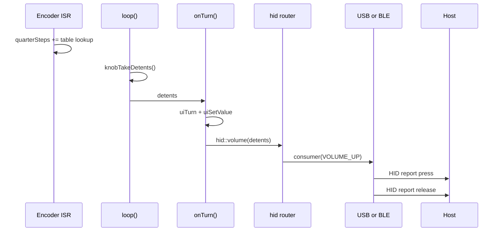
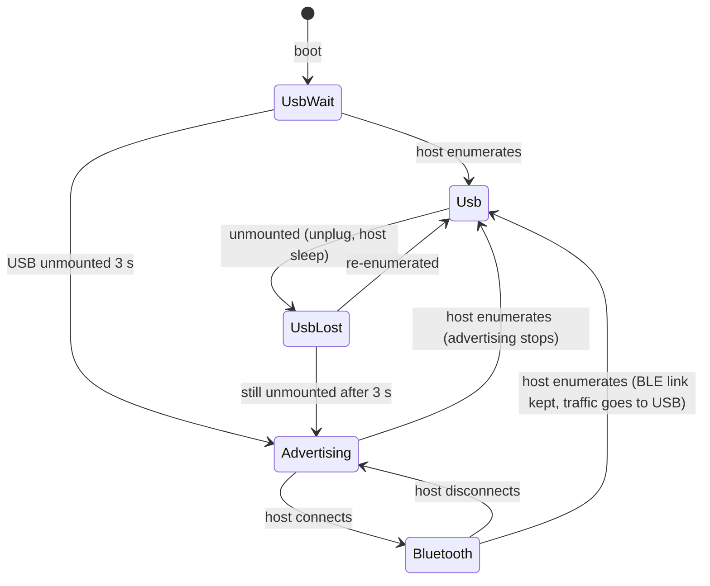
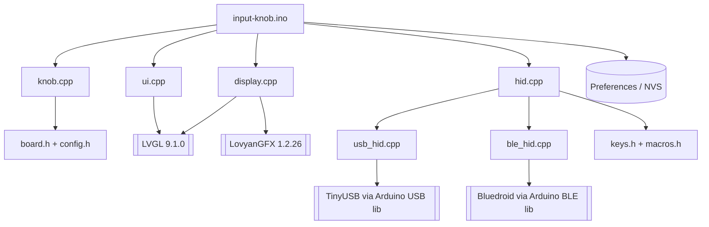

# Architecture

## System Overview

Input Knob is a single Arduino sketch running on an ESP32-S3. It is a polling super-loop: each pass reads the encoder and button, runs the action for the current mode, lets the HID layer maintain its connections, and gives LVGL time to redraw. Input actions go through one router (`hid.cpp`) that sends them to whichever transport is live: USB when a host has enumerated the knob, otherwise Bluetooth LE. The firmware has no networking, no persistent storage beyond one preference, and no host-side software.

### Top-Level Architecture

```
  ┌───────────────────────────────────────────────────────────────────────┐
  │ ESP32-S3 (Arduino core 3.x)                                           │
  │                                                                       │
  │  GPIO45/42 ─ISR─► ┌──────────┐ detents  ┌─────────────────┐           │
  │  GPIO41 ─poll───► │ knob.cpp │ ───────► │ input-knob.ino  │           │
  │                   └──────────┘ events   │  Mode: Volume / │           │
  │                                         │  Scroll / Macro │           │
  │                                         └───┬─────────┬───┘           │
  │                              uiSetValue etc │         │ hid::volume…  │
  │                                    ┌────────▼──┐  ┌───▼──────────┐    │
  │                                    │  ui.cpp   │  │   hid.cpp    │    │
  │                                    │  (LVGL 9) │  │   router     │    │
  │                                    └────┬──────┘  └──┬────────┬──┘    │
  │                                    ┌────▼──────┐  ┌──▼──────┐ ┌▼────────┐
  │                                    │display.cpp│  │ usb_hid │ │ ble_hid │
  │                                    │ LovyanGFX │  │ TinyUSB │ │Bluedroid│
  │                                    └────┬──────┘  └──┬──────┘ └┬────────┘
  └─────────────────────────────────────────┼────────────┼─────────┼──────┘
                                       SPI 80MHz      USB OTG   BLE radio
                                   ╔═════▼══════╗ ╔═════▼════╗ ╔══▼═══════╗
                                   ║ GC9A01 LCD ║ ║ USB host ║ ║ BLE host ║
                                   ╚════════════╝ ╚══════════╝ ╚══════════╝
```

---

## Component Map

### Application (`input-knob.ino`)

**Responsibility**: Owns the mode state machine and maps every turn and button event to a host action and a screen update.
**Interfaces**: Arduino `setup()` / `loop()`.
**Dependencies**: `knob.h`, `hid.h`, `ui.h`, `display.h`, `macros.h`, `config.h`, `Preferences` (NVS).

State: `mode` (Volume / Scroll / Macro), `horizontalScroll`, `selectedMacro`, `macShortcuts` (persisted under NVS namespace `input-knob`, key `mac`), and `shownLink` (last link state drawn).

### Input (`knob.h`, `knob.cpp`)

**Responsibility**: Turn raw GPIO into detents and button gestures.
**Interfaces**: `knobBegin()`, `int knobTakeDetents()`, `ButtonEvent buttonPoll()` → `None | Click | DoubleClick | LongPress`.
**Dependencies**: `board.h`, `config.h`.

- The encoder A/B pins fire `onEncoderEdge()` on every change. The ISR looks up a 16-entry quadrature table and accumulates quarter-steps under a `portMUX` spinlock. `knobTakeDetents()` converts every 4 quarter-steps into one detent. Using interrupts means no steps are lost while LVGL is busy drawing.
- The button is polled: 25 ms debounce, a long press fires *while held* (600 ms), and a single click is reported only once the 300 ms double-click window has closed.

### HID router (`hid.h`, `hid.cpp`)

**Responsibility**: Expose host actions (`volume`, `mute`, `playPause`, `scroll`, `middleClick`, `runMacro`) and choose a transport for each one.
**Interfaces**: `hid::begin()`, `hid::service()`, `hid::link()` → `None | Usb | Bluetooth | Pairing`.
**Dependencies**: `usb_hid.h`, `ble_hid.h`, `keys.h`, `macros.h`.

Routing rule: if `usbhid::mounted()` → USB; else if `blehid::connected()` → Bluetooth; else the action is dropped. `service()` turns BLE advertising on after USB has been unmounted for 3 s and off as soon as USB mounts.

### USB transport (`usb_hid.h`, `usb_hid.cpp`)

**Responsibility**: TinyUSB composite HID (consumer control + keyboard + mouse), plus a watchdog that recovers lost enumeration.
**Interfaces**: `begin`, `service`, `mounted`, `consumer(usage)`, `scroll(v, h)`, `click(buttons)`, `keys(modifiers, key)`.
**Dependencies**: Arduino core `USB`, `USBHIDConsumerControl`, `USBHIDKeyboard`, `USBHIDMouse`, `esp32-hal-tinyusb.h`.

`#error`s at compile time unless the board is built with `USB Mode = USB-OTG (TinyUSB)`.

### Bluetooth transport (`ble_hid.h`, `ble_hid.cpp`)

**Responsibility**: HID over GATT using the core's Bluedroid `BLE` library.
**Interfaces**: same four send functions as USB, plus `connected`, `advertising`, `setAdvertising(bool)`.
**Dependencies**: `BLEDevice`, `BLEHIDDevice`, `BLESecurity`, `BLEServer`.

One report map with three report IDs: keyboard (1), mouse with wheel and horizontal pan (2), and consumer control (3). Pairing is "Just Works" with bonding (`ESP_LE_AUTH_BOND`), advertised with the keyboard appearance (`0x03C1`) under the name **Input Knob**.

### Display (`display.h`, `display.cpp`) and UI (`ui.h`, `ui.cpp`)

**Responsibility**: `display.cpp` powers the LCD rails, sets the backlight PWM, configures LovyanGFX for the GC9A01 (SPI2, 80 MHz, inverted colours) and registers it as an LVGL display with two 40-line RGB565 buffers in PSRAM. `ui.cpp` builds the screen.
**Interfaces**: `displayBegin()`, `displayLoop()`; `uiBegin()`, `uiSetMode()`, `uiSetValue()`, `uiTurn()`, `uiSetLink()`.

Screen layout (240x240 round):

```
            ╭──────── dial ring (arc, 30° segment follows the knob) ────────╮
            │                      USB                ← link (12pt, colour)  │
            │                    Volume               ← mode (20pt, colour)  │
            │                                                                │
            │                     Vol +               ← value (28pt)         │
            │                                                                │
            │              click mute | 2x play       ← hint (14pt, grey)    │
            ╰────────────────────────────────────────────────────────────────╯
```

### Static tables (`board.h`, `config.h`, `keys.h`, `macros.h`)

`board.h` is the pin map taken from Elecrow's examples and schematic. `keys.h` holds raw HID usage codes so both transports send identical bytes. `macros.h` has `MAC_MACROS[]` and `PC_MACROS[]`, and a `static_assert` keeps them the same length.

---

## Data Flow

### A turn of the knob, in Volume mode

```
 Encoder pins     knob.cpp          input-knob.ino       hid.cpp          usb_hid / ble_hid       Host
     │                │                   │                  │                    │                 │
     │── edge (ISR) ─►│ quarterSteps += … │                  │                    │                 │
     │                │                   │                  │                    │                 │
     │         loop() │◄─ knobTakeDetents ┤                  │                    │                 │
     │                │── detents = +1 ──►│                  │                    │                 │
     │                │                   │── uiTurn/SetValue (LVGL redraw next displayLoop)        │
     │                │                   │── hid::volume(1)►│                    │                 │
     │                │                   │                  │── useUsb()? ──────►│ consumer(0xE9)  │
     │                │                   │                  │                    │── press+release►│
```

1. **Edge** — every change on GPIO45/42 runs `onEncoderEdge()`, which adds ±1 quarter-step.
2. **Detent** — `loop()` calls `knobTakeDetents()`; four quarter-steps make one detent (sign flipped if `ENCODER_REVERSED`).
3. **Mode action** — `onTurn()` rotates the dial ring, updates the value label and calls `hid::volume(detents)`.
4. **Route** — `hid.cpp` picks USB if mounted, else Bluetooth if connected, else drops the action.
5. **Send** — the transport sends a consumer-control press then release (usage `0x00E9` volume up / `0x00EA` down).



### Choosing USB or Bluetooth



The screen's top label mirrors `hid::link()`: **USB** (green), **Bluetooth** (blue), **Bluetooth pairing...** (orange), **No connection** (red).

### USB recovery watchdog

`usbhid::service()` runs every loop. While unmounted it waits 3 s, then calls `tud_disconnect()`, and 200 ms later `tud_connect()`, so the host sees a fresh device and enumerates it again. It retries every 30 s. The work is spread across loop passes with timestamps rather than `delay()`, so Bluetooth use on a power bank (where USB is never mounted) doesn't stutter.

---

## Dependency Graph



---

## Key Design Decisions

### One router, two transports with the same send functions

**Context**: USB came first; Bluetooth had to be added without touching the modes.
**Options considered**: separate code paths per transport inside each mode; a virtual base class; a router choosing between namespaces that share signatures.
**Decision**: Both `usbhid::` and `blehid::` expose `consumer / scroll / click / keys` and take raw HID codes from `keys.h`. `hid.cpp` picks one per call.
**Consequences**: Modes never know which transport is live. Adding a third transport means one more branch in the router. Both transports must send byte-identical reports, which is why the Arduino `Keyboard.press('c')` ASCII API isn't used.

### Automatic switching, USB wins

**Context**: The knob is always powered over USB-C, either from a computer or from a charger.
**Decision**: USB whenever enumerated; Bluetooth advertises only after 3 s without USB.
**Consequences**: Nothing to configure, and plugging into a computer can't create a second, duplicate Bluetooth pairing. You can't use Bluetooth while the knob is on a computer's USB port.

### Encoder on interrupts, button polled

**Context**: An LVGL redraw can take several milliseconds; polling the encoder at that rate drops steps on fast turns.
**Decision**: A pin-change ISR with a quadrature table; the button stays polled because its timing is in the hundreds of milliseconds.
**Consequences**: Smooth fast turns. The ISR uses `digitalRead`, which is fine here because the firmware never writes to flash at runtime apart from the occasional NVS write.

### USB starts before `setup()`

**Context**: With *USB CDC On Boot* enabled, the core calls `USB.begin()` before `setup()`, so the `ARDUINO_USB_STARTED_EVENT` fires before any handler is registered. The first version therefore always showed "USB not connected".
**Decision**: Query `static_cast<bool>(USB)` (started and mounted) instead of listening for events.
**Consequences**: Correct status. The USB product name can't be changed in `setup()`, so macOS lists the device as `ESP32S3_DEV`.

### Pin map and panel settings copied from Elecrow

**Decision**: `board.h` and the LovyanGFX config match Elecrow's Lesson03 example: SPI 80 MHz, 3-wire, colour inversion on, and GPIO1/GPIO2 driven high to power the LCD and header rails.
**Consequences**: Known-good on the hardware; anyone comparing against Elecrow's examples sees the same values.

---

## External Dependencies

| Dependency | Type | Purpose | Version |
|---|---|---|---|
| esp32 by Espressif (Arduino core) | Board package | Toolchain, TinyUSB, Bluedroid BLE, Preferences | 3.0.7 tested (Elecrow targets 3.3.8) |
| LVGL | Library | UI widgets and rendering | 9.1.0 (with Elecrow's `lv_conf.h`) |
| LovyanGFX | Library | GC9A01 SPI driver | 1.2.26 |
| esptool | Tool (bundled with core) | Flashing; `upload.sh` also clears the force-download flag | 4.6 |

---

## Performance Characteristics

- Super-loop with `delay(2)`; LVGL renders in partial mode into two 240x40 RGB565 buffers (~19 KB each) in PSRAM, falling back to internal RAM.
- Flash use: about 1.34 MB of the 3 MB app partition (42%), mostly Bluedroid.
- Each HID send blocks for at most the core's report timeout (100 ms) if the host isn't reading.

---

## Security Boundaries

- The knob only *sends* input. It accepts no commands from the host apart from standard USB/BLE housekeeping and the 1200-baud "reboot to bootloader" request on the USB serial port that uploads rely on.
- Anything on the USB cable can reflash it; there is no secure boot or flash encryption.
- Bluetooth pairing is "Just Works" (no PIN), so while the knob is advertising, any nearby device can pair with it and it would then send that device keystrokes. It only advertises when not on a computer's USB.
- Macros send fixed shortcuts; nothing types arbitrary text.

---

## Known Limitations

- **One Bluetooth host at a time.** To switch, disconnect or forget the knob on the current host.
- **Sleep recovery unverified.** The USB watchdog is implemented but hasn't yet been tested against a real Mac sleep/wake cycle.
- **USB name** shows as `ESP32S3_DEV` rather than "Input Knob".
- **Uploads can leave the board in download mode** (dark screen) because the core's reboot-to-bootloader sets `RTC_CNTL_FORCE_DOWNLOAD_BOOT` and esptool 4.6 doesn't clear it. `upload.sh` clears it; the Arduino IDE's Upload button doesn't, so replug after using it.
- **Unused hardware**: the CST816D touch panel, the 5-LED WS2812 ring on GPIO48, and the external header rail.
- **Battery level** over Bluetooth is a fixed 100%; the board has no battery.
