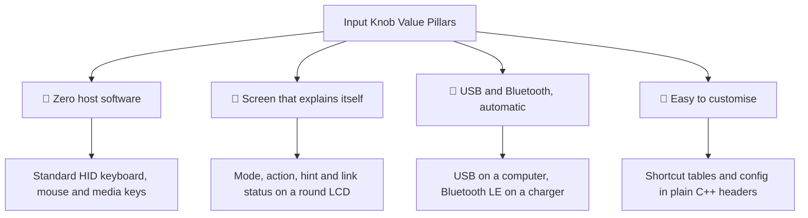
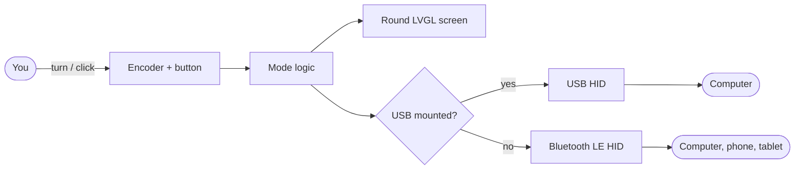
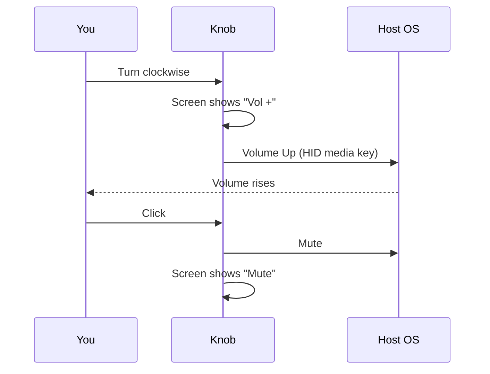

# Input Knob — Product Brochure

<div align="center">

```
   ╭───────────╮
  ╱   USB      ╲
 │    Volume    │     I N P U T   K N O B
 │    Vol +     │     one dial for volume, scrolling and shortcuts
  ╲  ◜‾‾‾‾‾◝   ╱
   ╰───────────╯
```

**Open-source firmware that turns a round-screen ESP32-S3 knob into a desk controller**

   

</div>

---

## 1. Product & Marketing Hook

> **"Stop hunting for the volume key: put a dial with a screen on your desk, and have it work with every computer and phone you own, with nothing to install."**

Volume, scrolling and the handful of shortcuts you use all day are buried in key combinations and menus. Off-the-shelf knobs fix part of that, but most are blind (no screen), fixed-function, or tied to a vendor app.

Input Knob runs on the Elecrow CrowPanel 1.28" rotary display: a detented rotary knob with a push button, around a round colour screen. It speaks plain HID, the same language as a keyboard and mouse, so macOS, Windows, Linux, iOS and Android accept it immediately. The screen always tells you which mode you're in, what a click will do, and whether you're on USB or Bluetooth.

---

## 2. Target Audience

- 🛠️ **Makers who own the CrowPanel 1.28"**: a genuinely useful daily-driver firmware in one command.
- 🎧 **People who live in audio and video calls**: instant mute and volume without leaving the current window.
- 💻 **Developers on more than one machine**: Mac and PC shortcut sets, switchable on the knob, over USB or Bluetooth.
- 🧩 **Tinkerers**: small, readable modules, so adding a shortcut or a whole mode is a few lines.

---

## 3. Purpose & Mission

Make the most common desk interactions physical and visible, without host software.

| | Before | With Input Knob |
|---|---|---|
| Change volume | Find keys or a menu-bar slider | Turn the dial |
| Mute for a call | Find the mute key, hope it's the right one | Click; the screen confirms **Mute** |
| Scroll a long doc | Trackpad swipes | Detented, precise wheel steps (vertical or horizontal) |
| Common shortcuts | Remember the combo for this OS | Pick by name on screen, click |
| Second device | Separate gadget | Same knob over Bluetooth |
| Setup | Vendor app, drivers | None: standard HID |

---

## 4. Core Value Propositions & Key Capabilities



- **Zero host software** — works on macOS, Windows, Linux, iOS and Android with no drivers.
- **Screen that explains itself** — the top shows the link (USB / Bluetooth / pairing), the middle shows the mode and the last action, and the bottom hints what click and double-click do.
- **USB and Bluetooth, automatic** — no switch to flip; Bluetooth pairing starts 3 s after USB goes away.
- **Four modes, one gesture set** — Volume, Scroll, Macro and Trackpad all use turn / click / double-click / long press, plus tap and swipe on the screen.
- **A trackpad in the knob** — drag on the round screen to move the cursor, tap to click, hold to right-click.
- **An LED ring that talks back** — mode colours, a needle that follows your turn, flashes for mute and macros.
- **Easy to customise** — add a shortcut by adding one line to each of two tables in `macros.h`.

---

## 5. Visual System Architecture





---

## 6. Instant Onboarding & Quick Start

```bash
git clone https://github.com/bsommers/input-knob.git && cd input-knob
git clone --depth 1 https://github.com/Elecrow-RD/CrowPanel-1.28inch-HMI-ESP32-Rotary-Display-240-240-IPS-Round-Touch-Knob-Screen.git /tmp/elecrow
mkdir -p ~/Documents/Arduino/libraries
cp -R /tmp/elecrow/example/Arduino/libraries/{lvgl,LovyanGFX,Adafruit_NeoPixel,lv_conf.h} ~/Documents/Arduino/libraries/
./upload.sh     # knob plugged in; it restarts into Volume mode
```

Needs the Arduino IDE 2 (or `arduino-cli`) with the **esp32 by Espressif** 3.x board package.

---

## 7. Where to Go for More Information

| Resource | Purpose | Direct Link |
|----------|---------|-------------|
| 📖 README | Overview, quick start, configuration | [README.md](../README.md) |
| 🏗️ Architecture | Modules, data flow, USB/Bluetooth switching | [ARCHITECTURE.md](ARCHITECTURE.md) |
| 🎯 Purpose | Goals, non-goals, trade-offs | [PURPOSE.md](PURPOSE.md) |
| 🚀 How-To | Pairing, shortcuts, new modes, troubleshooting | [HOWTO.md](HOWTO.md) |
